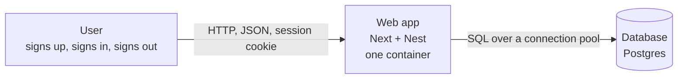
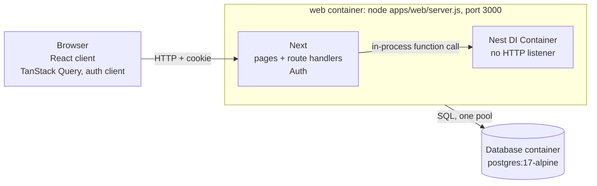
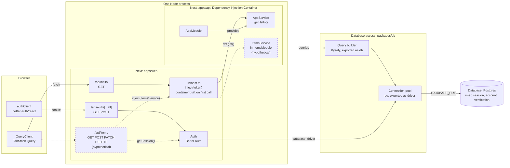
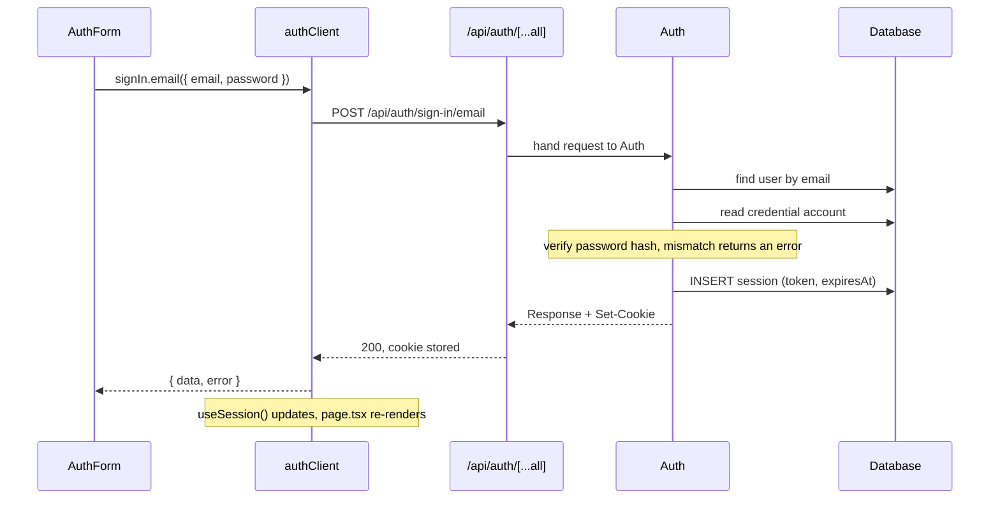
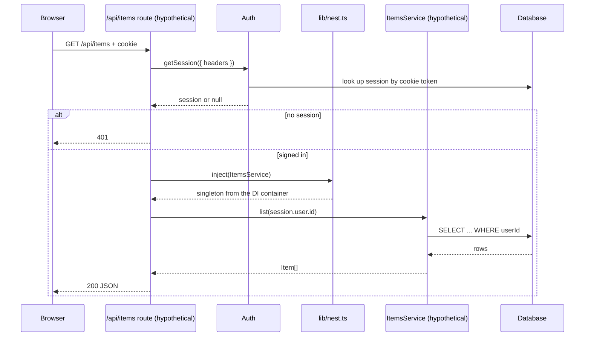
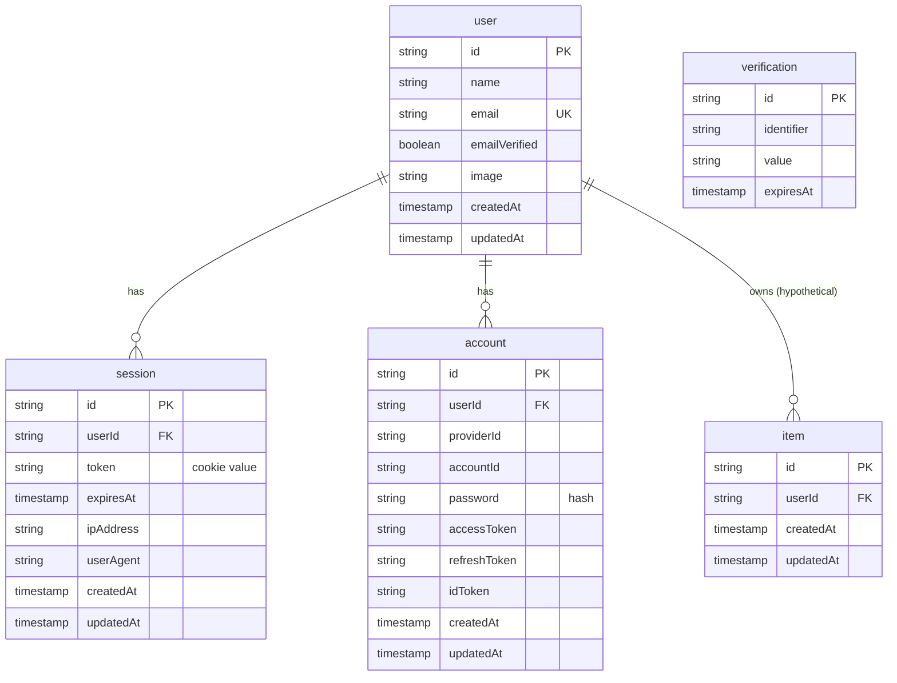

# Architecture

How a scaffolded app fits together when it's generated with Next, Nest, Better Auth and Postgres. Each level zooms in on a box from the level above it.

Next serves the pages and every `/api` route. Nest is not a server here: its modules are booted as an in-process Dependency Injection Container inside the Next server, and route handlers pull services out of it. Auth and the query builder share one connection pool to the database.

Dashed parts are hypothetical. They show a REST resource, `/api/items`, added the way this setup is built for. Nothing named `items` ships with the scaffold.

## Level 1: Context

Who uses it and what it depends on.

That's the whole outside world. There's no email provider, OAuth provider, cache, queue, or object store. Email addresses are never verified because nothing sends mail.

## Level 2: Containers

What runs where.

Next and Nest ship as one image and share one Node process, so a route handler calling a Nest service is a plain function call, not a network hop. The web container waits for the database's health check before it starts.

## Level 3: Components

Modules inside the process.

Route handlers own HTTP: the session check, body validation and status codes. Nest services own the logic and the queries. Without the hypothetical resource, the only database traffic comes from Auth.

## Level 4: Code

### A sign-in

Sign-up takes the same path through `/sign-up/email`, inserting a `user` and a credential `account` row before creating the session. The password hash lives on `account`, not `user`. Every later request carries the cookie, and server code reads it with `auth.api.getSession()`.

### A REST call (hypothetical)

Every protected verb follows this shape. POST and PATCH add one step after the session check: parse the body with a schema and return 400 on failure. Services throw Nest exceptions such as `NotFoundException`, and the handler turns them into status codes.

### Tables

`user`, `session`, `account` and `verification` belong to Better Auth; `verification` stays empty because nothing sends mail. `item` is hypothetical: one row per resource, owned by a user, read and written only by `ItemsService`.

## Workspaces

| Workspace                    | What it is                                                                   | Used by        |
| ---------------------------- | ---------------------------------------------------------------------------- | -------------- |
| `apps/web`                   | Next app: pages, route handlers, `lib/nest.ts` bridge, auth client           | entry point    |
| `apps/api`                   | Nest modules and services, exported as a library (`AppModule`, `AppService`) | web            |
| `packages/auth`              | The `betterAuth()` instance (email and password)                             | web            |
| `packages/db`                | Query builder (Kysely), connection pool (pg), table types                    | api, auth, web |
| `packages/ui`                | shadcn components on Base UI, Tailwind 4 globals, theme toggle               | web            |
| `packages/typescript-config` | Shared tsconfig bases                                                        | all            |
